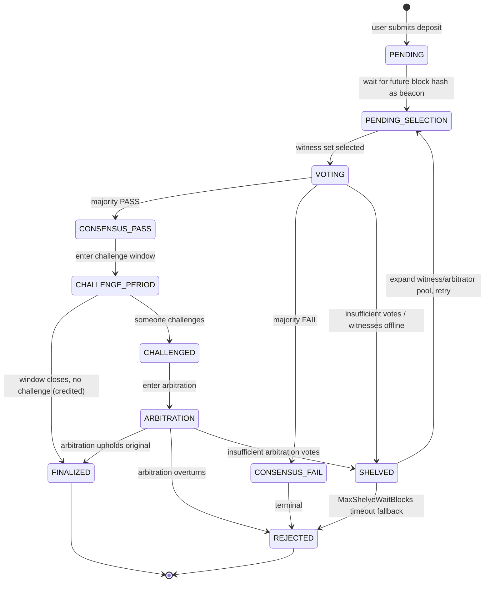
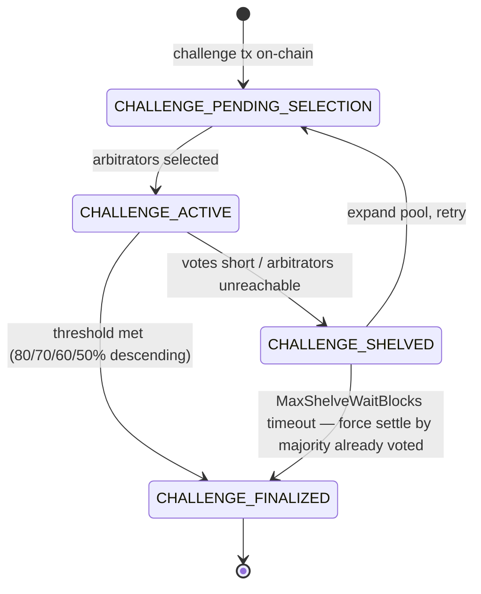
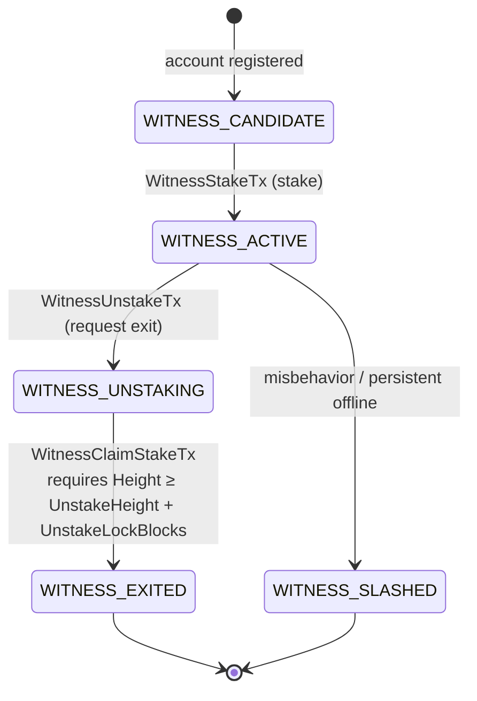
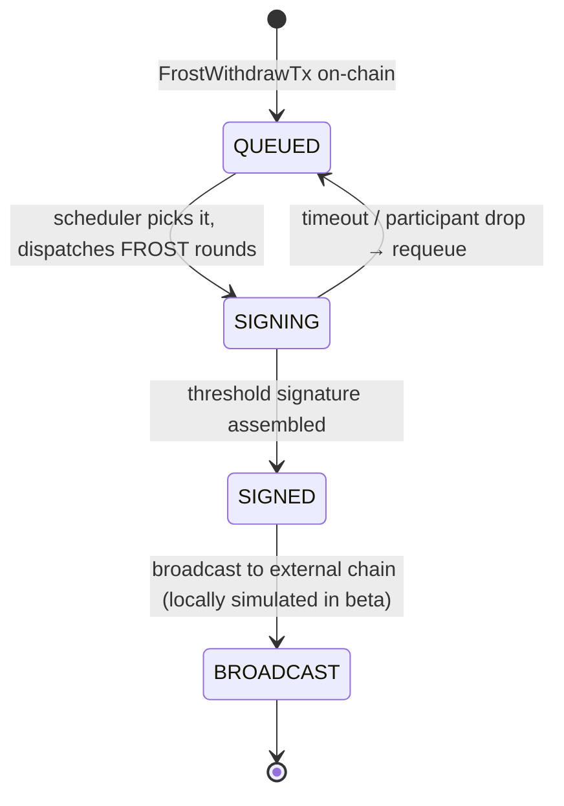

[简体中文](README.md) | **English**

# FrostBit Internal Test Guide

Welcome to the FrostBit internal beta! This handbook is a complete guide for testers, covering project background, reward rules, startup steps, frontend modules, caveats, and feedback channels.

---

## Table of Contents

- [0. Project Overview](#0-project-overview)
- [1. Internal Test Reward Rules](#1-internal-test-reward-rules)
- [2. Caveats (Read Before Testing)](#2-caveats-read-before-testing)
- [3. Release Package Layout & Startup](#3-release-package-layout--startup)
- [4. Wallet Connection & Separate Test Accounts](#4-wallet-connection--separate-test-accounts)
- [5. Frontend Modules](#5-frontend-modules)
- [6. Key State Transition Diagrams](#6-key-state-transition-diagrams)
- [7. FAQ](#7-faq)
- [8. Feedback Template (for GitHub Issues)](#8-feedback-template-for-github-issues)

---

## 0. Project Overview

**FrostBit** is a **fully decentralized** on-chain exchange — **no central operator, no central market maker, and even the cross-chain assets themselves are not held by any centralized custodian**. What you can do:

- **Spot trading** — Buy and sell any registered token on-chain, place/cancel limit orders, view order book depth and trade history
- **Perpetual futures** — Long/short both directions, select leverage, add/withdraw margin, watch mark price and funding rate; auto-liquidation at the liquidation line
- **Cross-chain deposits & withdrawals** — Bring BTC / ETH / BNB / TRX in as on-chain assets and take them back out the same way. **Assets are custodied collectively by the entire network; no single party can move your funds**
- **Token management** — Browse, issue, view holder distribution and trading pairs
- **Browser wallet** — Manage accounts, sign transactions, connect to DApps via the FrostBit Wallet extension
- **Block explorer** — Inspect blocks, transactions, addresses, and a live chain-wide transaction stream

> **Current stage**: internal beta (simulation). The entire system runs on a single machine — no servers, no real wallet, no real BTC required.

---

## 1. Internal Test Reward Rules

We want bugs, design flaws, and usability issues to surface early. Participation is simple:

### 1.1 How to file a bug

1. Open an issue in the **Issues** tab of this GitHub repository
2. **Title**: a one-sentence summary of the symptom
3. **Body** should contain at least:
   - Repro steps (which module, which button, what inputs)
   - Expected result vs. actual result
   - Your wallet address (copy from the FrostBit Wallet extension — used to pay reward tokens)
   - If possible, the last 20 lines from the node / Explorer services or a browser DevTools screenshot, after removing paths, IPs, accounts, and other identifying details

### 1.2 How rewards are calculated

- After mainnet launch, project tokens will be distributed to your supplied wallet address based on the **count of valid issues**
- "Valid" means: reproducible, non-duplicate, not an obvious misoperation
- **Quality bonus**: issues that attach a PoC, pinpoint the module/transaction type, or suggest a fix get extra weight
- **Severity bonus**: crash > asset loss > functional bug > UX issue

### 1.3 How to get your wallet address

After installing the FrostBit Wallet extension, **create a new account locally inside the extension** (set password → generate mnemonic → back up the mnemonic → done). The address shown at the top of the account detail page is yours. **This address is generated locally, the private key stays on your machine; just paste it into the issue. When mainnet launches, rewards are paid to the same address.**

> ⚠️ Do not use a node signing identity as a reward or routine testing wallet. Node keys must be held separately by the network operator outside the repository. Your reward address must be **an account you generated in the wallet whose private key nobody else has**.

> Note: issues are not limited to bugs — **improvement suggestions, documentation errors, UI issues** all count.

---

## 2. Caveats (Read Before Testing)

### 2.1 Fully local — no real cross-chain needed

This is the most commonly misunderstood point: **the entire FrostBit system runs on your own machine**. Don't mess with real BTC testnets, don't hunt for faucets, don't spend real bitcoin.

| Module | Theoretical (post-mainnet) | Internal test handling |
| --- | --- | --- |
| Block production / consensus / sync | Multiple physical nodes across data centers | 30 local processes — behaviorally equivalent |
| Spot / perpetual matching | Real-time on-chain matching | Identical — local really is the chain |
| BTC / ETH deposit | Witnesses observe the external tx and vote on-chain | **The external tx hash can be filled in arbitrarily**. The witness voting flow still runs — you can use this to test "rejection of fake hashes", "duplicate-hash deduplication", "multi-round voting", etc. |
| BTC / ETH withdrawal | After FROST signing completes, a node broadcasts to the external chain | The signing flow runs end-to-end; the broadcast step is locally simulated. You get full visibility into FROST rounds, signer set selection, timeout retries, etc. |
| Wallet extension | Install in any Chrome / Edge | Load the `wallet/` directory; everything stays on your machine during the beta |

### 2.2 Data can be wiped at any time

A disposable local network can be rebuilt from block 0: stop the node and Explorer, then delete only their explicitly mounted data directories. Never delete or copy the secret directory with them. See [Section 3.6](#6-start-a-fresh-chain-optional).

### 2.3 This is a simulation prototype, not a production build

- The runtime now enforces one identity per process. Local multi-node Compose still shares one host and does not represent independent failure domains
- Performance numbers are indicative only, not production metrics
- **Primary testing focus: do the numbers and accounting match expectations?** For each operation, compute it by hand and compare with what the chain shows:
  - **Order placement / fill**: is the frozen amount on placement correct? After a fill, does the buyer/seller balance delta equal `fill_qty × fill_price`? For partial fills — is the remaining order, fee deduction, and post-cancel refund accurate?
  - **Perpetuals**: opening margin, liquidation price, unrealized PnL, funding settlement, available balance after margin add/withdraw — all strictly consistent?
  - **Cross-chain deposit / withdrawal**: credited amount after witness pass = declared amount − fee? Withdrawal debit, lock, broadcast status transitions — every number lines up?
  - **Token supply**: after mint/transfer/burn, total supply is conserved; sum of all holder balances equals total supply
  - **Miner rewards**: block rewards distributed per the rule; total aligned with block count
- When filing issues, please write **"I calculated X, the UI shows Y"** so we can pinpoint quickly

### 2.4 Ports and firewall

- One node uses **6000** for consensus by default and Explorer uses **8080** for the web service. Use **7000** for pprof only during local diagnostics
- A multi-node network needs a separate process, address, and secret mount per identity. Never expose debug APIs or pprof in production

---

## 3. Release Package Layout & Startup

### Download the release

1. Open the anonymous public repository supplied by the publisher and go to **Releases**
2. Choose the Linux asset matching the server architecture, such as `dex-vX.Y-linux-amd64.zip` or `dex-vX.Y-linux-arm64.zip`
3. Extract it into a controlled directory such as `/opt/dex`; the result has the layout below
4. All subsequent steps use this extracted `dex` directory as the working directory

> 💡 Windows node releases are disabled until a named-pipe or inherited-handle secret launcher exists. Package Windows Explorer separately if needed; it must not share the node bundle's security promise.
>
> 💡 Extract each upgrade into a new empty directory. Mount data and secrets separately, then back up and validate configuration before switching.

### Release package structure

```text
dex/
├── dex                   ← One chain-node process
├── explorer              ← Explorer backend
├── miner-register        ← One-shot miner registration tool
├── frostbit-node         ← Published-image quick-start command
├── start-dex-node        ← FD launcher that only opens external secret files
├── README.md            ← Simplified Chinese version
├── README.en.md         ← This file (English)
├── config/runtime/       ← Selected public runtime configuration
├── explorer_web/dist/    ← Frontend static assets
└── wallet/               ← FrostBit Wallet browser extension
```

The node includes automatic updates, enabled by default with `--auto-update=true`; use `--auto-update=false` to stop checking for new versions. No separate updater executable or service is required. Updates come from this repository's official immutable Releases and use `<data-dir>/.node-updates` by default, preserving network configuration, database, and keys. GitHub CLI with `gh release verify-asset` is required. The node exits gracefully to apply an update only after verifying that its original systemd unit restarts exit code 75. Manual launches, Docker, and services without automatic restart prepare the update and commit it after a normal shutdown for the next launch.

### Miner quick start (recommended)

The quick path consumes the Docker image and sha256 digest published with the
release. It does not require source code, Git, or a Go toolchain. Prepare the
five public configuration files from the same release, the node private-key
file, and an independent wrap key when FROST is enabled, then run:

```sh
sudo ./frostbit-node up \
  --image REGISTRY.example/frostbit-node:vX.Y.Z@sha256:REPLACE_WITH_RELEASE_DIGEST \
  --network-dir "$PWD/config/runtime" \
  --private-key-file /secure-import/miner/private_key \
  --frost-wrap-key-file /secure-import/miner/frost_wrap_key \
  --reward-address REPLACE_WITH_FIXED_FBC_REWARD_ADDRESS \
  --explorer-url https://REPLACE_WITH_NETWORK_EXPLORER
```

This pulls the pinned image, validates configuration, derives the miner address
from the private key, selects one unambiguous public IPv4 address, and starts a
persistent data volume. Add `--advertise-endpoint PUBLIC_IPV4:6000` on NAT or
multi-address hosts. After synchronization, verify TCP/UDP reachability from
another host and same-height block-ID agreement, then run the second command:

```sh
sudo ./frostbit-node register --confirm-ready
```

The direct `dex` / `start-dex-node` instructions below remain an advanced
binary-process deployment reference; they are not required by quick start.

### 1. Preparation

- Keep the release directory intact; binaries depend on the sibling public `config/` and `explorer_web/dist/`
- Outside the release directory, prepare a read-only `private_key` for this node and an independent `frost_wrap_key` when FROST is enabled. Empty files and sample text fail closed and must not be committed
- Grant read access only to the node service account and disable core dumps
- If `CONFIGURATION_REQUIRED` exists at the archive root, this is deliberately a
  **non-runnable public template**. It has no validator identity. Generate one
  coherent network configuration, replace all five files under `config/runtime/`,
  and validate the source profile with release `--config-mode=runnable` before
  starting a node. Never put a private key in `config/runtime/`.
- **Install the FrostBit Wallet browser extension**:
  1. On an administrator workstation, open Chrome / Edge and navigate to `chrome://extensions`
  2. Toggle **Developer mode** in the top-right
  3. Click **Load unpacked** and select the `wallet` directory from the release package
  4. The FrostBit Wallet icon will appear in the browser toolbar

  > After unpacking a new version, reload the extension: in `chrome://extensions`, find FrostBit Wallet and click the refresh icon.

### 2. Start one chain node

The node enforces one identity per process and never reads a private key from `peers.json`. `start-dex-node` places only secret **paths** in the environment, opens those files directly as descriptors 3/4, and passes descriptor numbers to the node. Key bytes never enter argv or environment variables.

```sh
export MINER_ADDRESS=replace-with-derived-miner-address
export DEX_NODE_BIN="$PWD/dex"
export DEX_PRIVATE_KEY_FILE="/secure/$MINER_ADDRESS/private_key"
export DEX_FROST_WRAP_KEY_FILE="/secure/$MINER_ADDRESS/frost_wrap_key"

# EXAMPLE endpoint only: replace node.invalid with this node's public endpoint.
./start-dex-node \
  --bootstrap-mode=genesis \
  --config-dir="$PWD/config/runtime" \
  --peers="$PWD/config/runtime/peers.json" \
  --expected-address="$MINER_ADDRESS" \
  --data-dir="/var/lib/dex/$MINER_ADDRESS" \
  --resume=true \
  --advertise-addr=node.invalid:6000 \
  --no-simulator
```

For production, prefer the public repository's Docker/Kubernetes templates or `deploy/secure-node/` wrapper. Every identity needs its own process and secret mount.

### 3. Start Explorer

Open another terminal. If no node runs locally, replace `--nodes` and `--sync-node` with a trusted network node:

```sh
./explorer \
  --config-dir="$PWD/config/runtime" \
  --peers="$PWD/config/runtime/peers.json" \
  --listen=127.0.0.1:8080 \
  --nodes=127.0.0.1:6000 \
  --sync-node=127.0.0.1:6000 \
  --web-dir="$PWD/explorer_web/dist" \
  --data-dir=/var/lib/dex/explorer
```

Success when you see `Explorer listening at http://127.0.0.1:8080`.

### 4. Open the frontend

In your browser, visit: **<http://127.0.0.1:8080>**

Use Chrome or Edge. Once loaded, the top-right corner offers a **language toggle** between Chinese and English.

### 5. Shutdown order

When done, **stop the explorer first, then the chain**:

1. Send `SIGTERM` to Explorer and wait for it to exit
2. Then send `SIGTERM` to the node and wait for state writes to finish

> Force-killing a node may corrupt in-flight block data. Always shut it down gracefully.

### 6. Start a fresh chain (optional)

To wipe all history and restart from block 0:

1. Confirm both node and Explorer processes are stopped
2. Delete only the explicitly mounted node data directory (never the secret directory)
3. Delete the Explorer data directory
4. Restart by repeating steps 2 and 3

---

## 4. Wallet Connection & Separate Test Accounts

Any operation involving orders, deposits, withdrawals, or token issuance requires a connected wallet. Installation: see [3.1](#1-preparation).

### 4.1 Create a separate test account

The node does not generate or export miner private keys. `peers.json` contains only public identities and bootstrap routes. The network operator injects each node signing key from an out-of-repository secret file through an inherited descriptor; never copy that key into a browser wallet.

1. Open the FrostBit Wallet extension from the toolbar
2. Choose **Create account** and set an independent wallet password
3. Back up the mnemonic offline as instructed; never paste it into an issue, chat, or terminal
4. Give the new account address to the test-network operator to request test funds

For a disposable local development network only, an operator may use identities generated solely for that network and never used with real assets. Those keys still must not enter a release package or Git repository.

### 4.2 Connect the wallet

1. Open the Explorer page (`http://127.0.0.1:8080`)
2. Click **"Connect Wallet"** in the top-right
3. In the extension popup, pick an account and approve
4. Once connected, the top bar shows the current address and balance

Clicking a trade button while disconnected shows a "Please connect wallet first" prompt.

> 💡 **The wallet address you file with an issue** is any account's address from the extension — use the one you mainly test with.

---

## 5. Frontend Modules

After opening the frontend, the left-side nav shows **10 modules**. Below, in nav order:

### 5.1 Node Monitor

The default home page — watch the whole chain run.

**What to look at:**
- The left-side available-node pool lists nodes from the current public manifest and Explorer configuration, with single or multiple selection
- Selected nodes appear in the top control center with live height, accepted height, latency, FROST task count, pending tx count, candidate block count
- Each node card has a status badge: **online / offline / warning / paused**
- Miner nodes also show **miner status** and liveness
- "Block metadata" toggle: shows latest block's miner / state root / tx type distribution
- "Frost metrics" toggle: shows memory, goroutine count, FROST task count, etc.

**What you can do:**
- **Start/stop mining**: toggle miner status on any node to test dynamic join/leave
- **Pause/resume node**: simulate offline scenarios and observe catch-up
- **Snapshot sync toggle**: whether a new node uses snapshot or sync-from-zero
- **Auto sync**: refreshes selected-node status every 5 seconds
- Click a node card to open a detail modal with recent logs and blocks
- Click the "candidate blocks" number to pop up the list of unfinalized block headers

### 5.2 Block Explorer

Manual chain-data lookup.

**The search box accepts 4 input types**: block height, block hash, transaction hash, account address.

**Detail pages:**
- **Block detail**: height, hash, parent hash, state fingerprint, miner, tx list, block reward
- **Transaction detail**: hash, type, sender, type-specific payload (transfer, order, DKG participation, threshold signature, etc.)
- **Address detail**: balance, tx history, filter by type

A **recent blocks** feed sits below for quick drill-in.

### 5.3 DEX Pool

Test spot and perpetual orders. Two tabs:

#### Spot
- **Pair dropdown**: searchable; pick a registered pair or type manually
- **Order book**: real-time buy/sell depth, click to copy a price
- **Trade history**: recent matches
- **Limit orders**: connect wallet, enter price and quantity, place buy/sell
- **My orders**: filter by open / filled / all

#### Futures
- Top metrics: **mark price, spot price, index price, funding rate, insurance fund** (live)
- **Current position**: long/short direction, size, entry price, liquidation price, unrealized PnL
- **Margin operations**: per-position **add / withdraw margin** (with max-withdrawable hint)
- **Limit order** + **leverage picker**
- **My orders / order book / trade history** — same as Spot

> Both sub-tabs require "Connect Wallet" in the top-right first.

### 5.4 Withdraws

FROST-threshold-signed **cross-chain withdrawal queue**.

- Each withdrawal's state: queued / signing / signed / broadcast / completed
- Click any entry to open the detail modal: full **FROST rounds**, participating witnesses, external-chain tx info
- Used to verify: is the t-of-n threshold triggered correctly? Is signer selection uniform? Does timeout-retry work?

> In the internal test, the "broadcast" step is locally simulated — nothing actually hits the BTC chain. You can still see the full protocol rounds and signature data, which is the whole point.

### 5.5 Witness

The witness observation + voting flow for cross-chain events.

- List of pending witness requests (height, type, status)
- Each request expands to show which witnesses have signed / not
- Used to verify behavior under witness offline, disagreement, timeout, shelving

### 5.6 Miner

The miner-centric node list — complements "Node Monitor":

- Only shows the currently active miner set
- Shows **liveness status**, consensus height, recent block production
- Useful for confirming miner-set updates across miner joins/leaves and epoch changes

### 5.7 Bridge

Deposit / withdrawal entry points for BTC / ETH / BNB / TRX.

**Deposit test flow (locally simulated):**
1. Connect wallet
2. On the "Request deposit address" panel, click to generate a one-time receiving address
3. The **external tx hash** field — just fill any 64-hex string (e.g. paste a block hash). What we're verifying is the on-chain witness flow, not an actual fund movement
4. Fill amount and decimals (only needed for ERC20 / TRC20), submit
5. Switch to "Witness" to watch the vote
6. After the vote passes, the balance shows in the address detail

**Withdrawal test flow:**
1. In "Initiate withdrawal" form, fill token address, destination address, amount
2. Sign and submit
3. Switch to "Withdraws" to watch signing progress
4. After signing completes, the state moves to "broadcast" — which is locally simulated in this beta, nothing actually reaches the BTC chain

### 5.8 Frost DKG

FROST DKG (Distributed Key Generation) session timeline:

- Participants, current round, round timing per session
- Failures / retries
- Fingerprint of the generated public key
- Used to confirm the key is regenerated as expected after a miner-set change

### 5.9 Tokens

Token registry browse and lookup:

- Lists all issued tokens: symbol, supply, issuer, decimals
- Click for holder distribution and registered trading pairs
- Used to verify issue, mint, burn transactions on-chain

### 5.10 Recent Txs

A live scrolling view of the latest chain-wide transactions:

- Filter by tx type (transfer, order, cancel, deposit, withdrawal, DKG, signature, etc.)
- Click any tx for a detail modal — no need to jump to "Block Explorer"
- Useful as a "live monitor" during stress testing or regression checks

---

## 6. Key State Transition Diagrams

The four diagrams below map the pipelines most prone to getting stuck mid-state. During testing, use them as a reference: which cell is the on-chain state in, what's the next step, which edge is the timeout fallback?

### 6.1 Recharge Request (RechargeRequest)



**Testing focus**: the `SHELVED → PENDING_SELECTION` retry, the `SHELVED → REJECTED` timeout fallback, challenge window duration, whether balance correctly credits after `CHALLENGE_PERIOD → FINALIZED`.

### 6.2 Challenge & Arbitration (ChallengeRecord)



**Testing focus**: whether challenge stake is frozen correctly, whether arbitrator re-selection uses future block hash, whether the timeout fallback conservatively infers the outcome, whether post-settlement stake refund / slash reconciles.

### 6.3 Witness / Miner Lifecycle (WitnessStatus)



**Testing focus**:
- After `ACTIVE → UNSTAKING`, the witness **is immediately excluded from new tasks**, but must finish `pending_tasks` leftover
- Calling `WitnessClaimStakeTx` before the lock period (`UnstakeLockBlocks`, default 20 blocks) should be rejected
- `witness_locked_balance` in `UNSTAKING` must not be movable before claim
- For the `WITNESS_SLASHED` path, watch where the slashed funds go (insurance fund / challenger)

### 6.4 Cross-chain Withdrawal (FROST Withdraw)



**Testing focus**: whether FROST rounds progress as expected, whether signer selection is balanced, whether timeout-retry actually falls back to `QUEUED` and reschedules, whether the `SIGNED → BROADCAST` tx hash can be cross-referenced.

---

## 7. FAQ

| Symptom | Steps to check |
| --- | --- |
| Browser blank at `127.0.0.1:8080` | Confirm the Explorer service is running and listening on 8080; inspect its logs, then refresh |
| All nodes show "offline" | Confirm the node service is running; use `ss -lntup` on the server to check port 6000, then verify manifest routes and firewall rules |
| Withdrawal stuck on "signing" | In "Frost DKG" check for an active DKG session; if miners < threshold, signing can't complete |
| Order submitted but book unchanged | Check "Node Monitor" for growing pending-tx count — confirm the tx entered a node's txpool |
| Data looks off after restart | Per [3.6](#6-start-a-fresh-chain-optional) wipe `data/` and `explorer_data/` then restart |
| Node startup reports port in use | A previous or unrelated service owns the port. Identify it through the service manager before acting; do not blindly force-kill processes |
| Frontend buttons unresponsive | Open browser DevTools (F12), look for red errors; screenshot and report |
| Wallet extension icon missing | In `chrome://extensions`, confirm the `wallet/` directory is loaded and "Developer mode" is on |
| Can't fill "external tx hash" for deposit | During beta, any 64-hex string will do — no real BTC tx required |

---

## 8. Feedback Template (for GitHub Issues)

```markdown
### Symptom
One sentence (e.g.: After adding margin to a perpetual position, the UI's unrealized PnL didn't refresh)

### Repro steps
1. Start one test node through the FD launcher, then start Explorer
2. Open frontend → Connect Wallet (account 0)
3. Navigate to DEX Pool → Futures
4. Place a BTC/USDT 10x long
5. Click "Add margin" 100 USDT

### Expected
Unrealized PnL refreshes with the new margin

### Actual
Number stays the same until page is refreshed

### Environment
- Node count: 30 (default)
- Data wiped: yes / no
- Snapshot sync: on / off

### My wallet address (for rewards)
fbc1q...xxxx

### Attachments
- Last 20 sanitized lines of node service output (optional)
- Browser DevTools console screenshot (optional)
```

---

Happy testing — we look forward to your issues!
