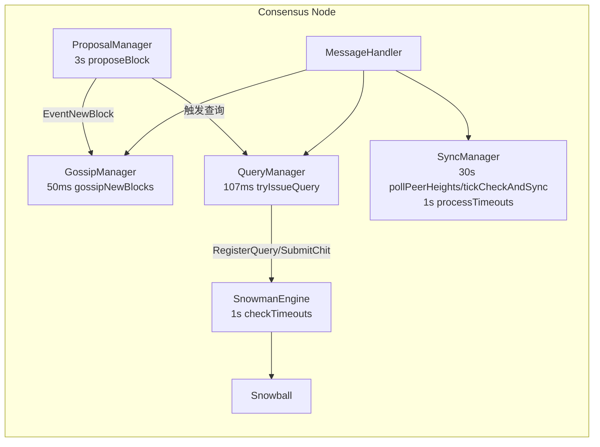
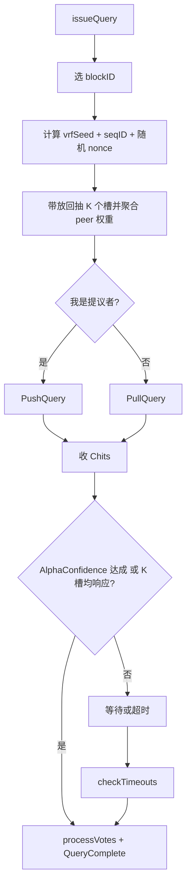
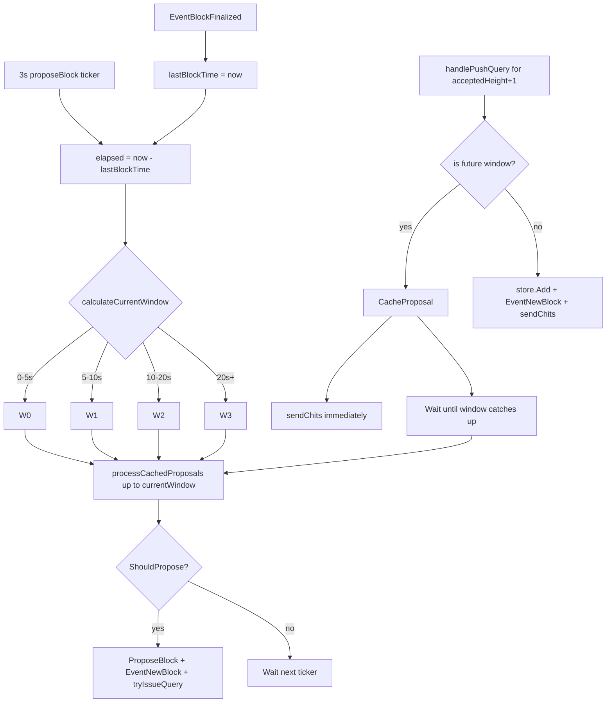

# Consensus 模块设计文档（与当前实现同步）

本文档按当前代码实现更新，主要参考：

- `consensus/consensusEngine.go`
- `consensus/snowball.go`
- `consensus/queryManager.go`
- `consensus/proposalManager.go`
- `consensus/messageHandler.go`
- `consensus/sync_manager.go`
- `consensus/sync_session.go`
- `consensus/frontier_protocol.go`
- `consensus/frontier_sync.go`
- `consensus/gossipManager.go`
- `consensus/config.go`

---

## 1. 模块概览

共识模块实现链式 Snowman 风格共识，核心特征是：

1. 只在“父块已最终化”的前提下推进下一高度。
2. 查询采样采用 VRF 种子 + `seqID` 的确定性采样。
3. 生产状态机使用 Snowball 的累计偏好与近期连续置信度两条独立轨道；失败轮只清空连续置信度，不按时间、window 或 hash 直接切换偏好。
4. 同步把 peer 高度当作触发提示，通过统一 session 状态机执行；浅层追块由 fixed-K/AlphaConfidence accepted-frontier 门禁，深层追赶先验证 checkpoint 证书和快照锚。

---

## 2. 关键默认参数

### 2.1 共识参数（`consensus/config.go`）

| 参数 | 默认值 | 说明 |
|------|--------|------|
| `K` | 15 | 每轮固定采样数 |
| `AlphaPreference` | 8 | 软阈值；严格多数即可给赢家累计一次 `strength` |
| `AlphaConfidence` | 12 | 硬阈值；推进连续 `confidence`，也是 poll 提前结束阈值 |
| `Beta` | 15 | 同一硬多数候选所需的连续成功轮数 |
| `PollInterval` | 25ms | 查询轮次的唯一调度间隔 |
| `QueryTimeout` | 4s | 查询超时 |
| `MaxConcurrentQueries` | 8 | 最大并发查询 |
| `ProposalInterval` | 3s | 提案周期 |
| `Gossip.Interval` | 50ms | gossip tick |
| `Gossip.Fanout` | 15 | gossip 扇出 |

### 2.2 同步参数（`consensus/config.go`）

| 参数 | 默认值 | 说明 |
|------|--------|------|
| `CheckInterval` | 30s | 定时同步检查周期 |
| `BehindThreshold` | 2 | 落后阈值 |
| `BatchSize` | 50 | 每轮拉取高度范围 |
| `Timeout` | 10s | 同步请求超时 |
| `FrontierPollTimeout` | 2s | 请求方本机单调计时的 accepted-frontier 固定 K/AlphaConfidence 轮次超时；不进入线协议 |
| `Frontier K/AlphaConfidence` | 15 / 12 | 固定复用共识 `K/AlphaConfidence`；frontier 绝不使用软阈值 `AlphaPreference` |
| `DeepLagStateSyncThreshold` | 10 | 默认深度落后阈值（stateDB-first 路径；配置为 0 时防御性回退为 100） |
| `StateSyncPeers` | 4 | stateDB 分片同步 peer 上限 |
| `StateSyncShardConcurrency` | 8 | stateDB 分片并发数 |
| `StateSyncPageSize` | 1000 | stateDB 分页大小 |
| `ChitSoftGap/HardGap` | 1 / 3 | Chit 软/硬触发差距 |
| `ChitGracePeriod` | 1s | 软触发等待 |
| `ChitCooldown` | 1.5s | 触发冷却 |
| `DeepLagMinAdditionalPeers` | 2 | 深度落后提示启动 checkpoint/cert 前要求的额外独立 peer 数；浅同步不使用 |

---

## 3. Snowball 决策逻辑（已更新）

### 3.1 候选过滤

`SnowmanEngine.processVotes` 只允许当前高度里 **父块等于已最终化父块** 的候选参与投票统计，其他票会被丢弃。

### 3.2 首次候选初始化

同一高度的第一个完整验证通过并注册进状态机的候选会初始化为当前 `preference`，但它的 `strength=0`、`confidence=0`。初始化只让节点有一个可查询、可回复的起始偏好，不等价于赢得一轮采样。

后续候选到达不会仅凭传播先后、时间、window 或 block hash 覆盖该偏好；偏好变化只能来自后续 Snowball 采样累计。

### 3.3 两级成功路径

每轮对合法候选计票后，软阈值和硬阈值分别生效：

1. 赢家达到 `AlphaPreference=8` 时，其累计 `strength++`；持久 `preference` 由累计强度决定。这条轨道吸收多轮轻微多数，避免一轮网络抖动直接改写长期偏好。
2. 赢家达到 `AlphaConfidence=12` 时，独立推进近期连续置信度：若仍是同一 `confidencePreference`，则 `confidence++`；若硬多数候选改变，则切换 `confidencePreference` 并从 `confidence=1` 重新累计。
3. 硬多数成功轮的投票明细可临时记录，用于本地最终化与观测；它不是可转移证据。

`strength` 回答“长期累计更偏向谁”，`confidence` 回答“最近是否连续看到同一个强多数”。两者不绑定：软多数可以改变累计强度，但不能代替硬多数推进最终化。

### 3.4 失败路径

本轮没有任何候选达到 `AlphaConfidence` 时，连续 `confidence` 归零；若仍有候选达到 `AlphaPreference`，它只累计自己的 `strength`。失败轮不会按累计失败次数、等待时间、window 或 hash 强制切换偏好，也不存在 failure escape。

### 3.5 最终化候选

当同一个 `confidencePreference` 连续 `Beta=15` 轮达到硬阈值时，最终化该近期连续硬多数候选。最终化选择不从累计 `preference` 猜测，因而即使历史累计强度暂时仍偏向另一个候选，也不会把错误的候选提交给 `SetFinalized`。

---

## 4. 查询与投票流程（已更新）

### 4.1 查询发起

`QueryManager.issueQuery`：

1. 仅针对 `lastAccepted+1` 高度发起查询。
2. 使用状态机当前偏好；若尚无偏好，则先把第一个已完整验证并按入池顺序注册的候选初始化为偏好，仍无合法候选时不发起 poll。不得按 window 或 hash 临时构造另一个偏好。
3. 生成 `vrfSeed = SHA256(parentID || height || window || nodeID)` 和 32-byte 随机 `queryNonce`，再计算本轮不可预知的 `sampleSeed = SHA256(vrfSeed || seqID || queryNonce)`。
4. 用生产与模拟器共用的 `BuildReplacementSample` 从排序去重后的完整矿工集合带放回抽取固定 `K` 个逻辑槽位。同一 peer 重复命中时只发送一次请求，其一次合法回复按本地预先注册的槽位数计票；peer 不能在报文中声明权重。抽样计划和起始候选快照随后交给双方共用的 `PollAccumulator`。
5. 仅提议者发 `PushQuery`（带 `Block`），其他节点发 `PullQuery`（仅 `BlockID`）。两类 V2 请求都按 peer 绑定指定 responder，并签名覆盖 chain、requestID、双方身份、完整内容、高度、VRF、seqID 与 nonce；报文不携带机器绝对时间。

### 4.2 查询节流与背压

- 节拍：所有提案、同步、收块和重试触发只唤醒同一个 scheduler，由 `PollInterval=25ms` 精确限速。
- 并发：受 `MaxConcurrentQueries` 限制。
- sender 控制队列拥塞时，自动进入 backoff；fanout 固定为 `K`（默认 15）。

### 4.3 查询完成与超时

- `SubmitChit` 与模拟器虚拟响应都通过同一个 `PollAccumulator.Record` 进入计票，并在两种条件下结束查询：
  1) 已注册候选达到硬阈值 `AlphaConfidence=12`；2) 已收到覆盖全部 `K=15` 个逻辑槽位的回复。软阈值 `AlphaPreference` 只在完整结算时累计强度，不能提前结束 poll。
- 每个采样身份最多接收一次 Chit。超时 peer 对应的全部槽位都算弃权，不重新抽样，也不缩小 `K` 或阈值。
- `checkTimeouts` 按发起方本机单调耗时扫描超时查询；即使超时也会先处理已收到的票，再发布 `EventQueryComplete(reason=timeout)`，不比较其它机器的绝对时间。
- `seqID` 在 poll 发出时立即消耗，避免并发 poll 复用；`QueryComplete` 负责清理 active poll，下一轮使用新的 seqID 和随机 nonce。

---

## 5. 区块提案流程（已更新）

### 5.1 Window 配置（来源 `config.Window`）

| Window | 时间段 | 概率 |
|--------|--------|------|
| `W0` | 0-5s | 5% |
| `W1` | 5-10s | 15% |
| `W2` | 10-20s | 30% |
| `W3` | 20s+ | 50% |

> 当前实现最后窗口不是 100%，而是 50%。

### 5.2 提案约束

`ProposalManager.proposeBlock` + `RealBlockProposer.ShouldPropose`：

1. 当前窗口由 `calculateCurrentWindow()` 按 `time.Since(lastBlockTime)` 计算（配置阶段：`W0->W1->W2->W3`）。
2. `lastBlockTime` 在 `EventBlockFinalized` 时更新，下一轮窗口从 `W0` 重新开始计时。
3. 每次 `proposeBlock` 会先执行 `processCachedProposals(currentWindow)`，把 `window <= currentWindow` 的缓存提案入库并发布 `EventNewBlock`。
4. 必须先拿到 `lastHeight` 对应的已最终化父块。
5. `currentBlocks` 只统计“父链匹配”的候选。
6. 早窗严格限流，晚窗放宽候选数上限（活性逃生）。
7. 空块仅允许在最后窗口（`window == lastWindow`）提出。
8. 本地提案成功后发布 `EventNewBlock`，并立即触发一次查询。

### 5.3 Window 切换与缓存回放（Mermaid）

---

## 6. 消息处理关键路径（已更新）

### 6.1 PullQuery

`handlePullQuery`：

1. 先验证 chain、requester、指定 responder、32-byte nonce 和完整 V2 签名；按本地 finalized 高度限制可接受窗口，并用有界、无 TTL 的时钟无关表抑制重复摘要。表满时淘汰最旧记录，不能因为本地高度不前进而永久拒绝新 poll。
2. 查询高度已经最终化：不依赖请求里的 blockID 是否仍在候选库，直接回该高度不可变的 finalized blockID。
3. 未最终化且本地有块：直接 `sendChits`。
4. 未最终化且本地无块：通过 `QueryManager.RequestBlock` 后台请求该块，立即按原 poll 上下文 `sendChits`；回复的是本地已完整验证的偏好，没有有效偏好就签名弃权，不给尚未验证的块投票。不保存挂起查询，也不在 `Put` 后补发旧 poll 的票。
5. 补块使用本机有界冷却表（最多 256 个 blockID、每块 5 秒），只向本次提供该 blockID 的 peer 发一次请求，不同时向 proposer 重复下载，也不叠加 HTTP 队列重试。表失效或重启只影响补块性能，不影响最终状态或共识规则。

### 6.2 PushQuery

`handlePushQuery`：

1. 先验证 chain、requester、指定 responder、32-byte nonce 和覆盖完整容器摘要的 V2 签名；使用与 PullQuery 相同的本地高度窗口和淘汰最旧记录的时钟无关防重放表。
2. 若高度已不新（`<= acceptedHeight`），直接回该高度 finalized blockID 的 `Chits`，不重入 store。
3. 仅对“当前待决高度（`acceptedHeight+1`）”执行 window 约束；未来窗口块会缓存到 `ProposalManager`。
4. 即使进入缓存路径，也会立即回 `Chits`，避免对端查询超时导致停滞。
5. 若 `store.Add` 返回数据不完整，交给 `PendingBlockBuffer` 异步补课，补齐后再回 `Chits`。
6. 若缺父块，主动请求父块。

区块正文仍限 2 MiB，PushQuery 外壳另留 16 KiB，HTTP 和 protobuf 解码同时约束。完整 Push/Get 默认使用 5 秒传输预算，Chit/PullQuery 保持小控制消息超时并复用控制队列；缓存中的近期候选补块享有独立、有限的响应槽，不与历史同步抢占同一每 IP 槽。

### 6.3 Chits 发送规则

`sendChits`：

1. 若查询高度已最终化，偏好必须是 `GetFinalizedAtHeight(queryHeight)` 的不可变 blockID；不能返回当前 Snowball 偏好或同高度其它候选。
2. 若查询高度尚未最终化且父高度未最终化则弃权（`preferred=""`）。
3. 未最终化高度的偏好块必须父链匹配，否则重选。
4. 回包附带 `AcceptedID/AcceptedHeight`，并回显查询的 32-byte nonce。
5. 偏好票和弃权票都附带 V2 ECDSA `ChitSignature`，签名绑定 chain、requestID、requester/responder、偏好及查询高度、accepted ID/height、VRF、seqID 和 nonce；任一字段被改写或跨轮移植都会验签失败。

---

## 7. 同步机制（已更新）

### 7.1 触发路径

1. 定时路径：`pollPeerHeights + tickCheckAndSync`。
2. 事件路径：已验签 Chit 的 `AcceptedHeight` 或 `HandleHeightResponse` 更新高度提示，再进入 `TriggerSyncFromChit`。
3. 高度响应只用于判断是否值得启动同步以及估算 target，不是区块 ID 或最终性证据。

### 7.2 高度提示与深提示确认

1. 位于 `DeepLagStateSyncThreshold` 内的提示可直接启动低成本 frontier 轮次；真正允许追块的是后续 K/AlphaConfidence 签名结果，而不是提示来源。
2. 超过深同步阈值的提示会启动昂贵的证书/快照流程，因此除触发 peer 外还要求 `DeepLagMinAdditionalPeers` 个独立 peer 确认。
3. 深提示目标取“所需确认数对应的第 N 高高度”，不会让单个 Byzantine 最大值决定 checkpoint 目标。
4. 周期路径优先使用已独立确认的深提示；若没有，则可使用阈值内最高提示进入 frontier。

### 7.3 事件路径（Chit 防抖）

1. `heightDiff == 1`：经过 grace 后启动轻量 frontier，只追一块，不设置全局 `Syncing=true`。
2. `heightDiff >= ChitHardGap`：阈值内提示可快速进入 frontier；超过深同步阈值时必须先完成独立 peer 高度确认，再进入 stateDB-first 路径。
3. `ChitSoftGap <= heightDiff < ChitHardGap`：经过 grace/cooldown 防抖后直接进入统一同步入口，由 frontier 完成后续认证。

### 7.4 执行与收包

统一状态机分为两条入口，最终汇合到同一个 frontier/追块循环：

1. 浅同步和普通追块：`plan -> frontier -> block_catch_up`。
2. 深度落后：`cert_chain -> state_snapshot -> fast_forward`；`CheckpointCertificate` 只验证并安装 checkpoint 锚，若 checkpoint 后仍有尾部差距，再进入 `frontier -> block_catch_up`。
3. 深同步开始前先通过 `/statedb/checkpoint/files` 获取文件清单，再通过 `/statedb/checkpoint/chunk` 分片下载；证书 state root 校验 manifest，安装前还要本地重算完整 checkpoint root。

每个 accepted-frontier 批次遵守以下规则：

1. 以当前本地 finalized tip 固定 `(anchorHeight, anchorBlockID)`，target 为高度提示与 `BatchSize`/未来块窗口共同限定的本批末端。
2. 固定采样 `Consensus.K=15` 个不同 miner，并发发送同一个带签名、chain ID 和 32-byte 随机 nonce 的 V2 请求。报文不携带或比较机器绝对时间；请求方仅按本机单调计时的 `FrontierPollTimeout` 关闭当前轮次。同步派发失败或超时的采样节点作为弃权；实际派发不足 `AlphaConfidence=12` 才立即失败，达到该数后继续收票，但不能缩小 K 或 AlphaConfidence。每个 peer 在一次响应中同时返回 `acceptedHeight`、`observedAnchorID`、`targetHeight` 和 `targetBlockID`，无需先问高度再问 blockID。
3. 只有 `Consensus.AlphaConfidence=12` 个已采样 peer 支持同一 `(targetHeight,targetBlockID)` 才进入下载。若 12 个 anchor-compatible 响应都低于 target，可按这一硬阈值可用的 accepted height 降低下一轮 target，但必须更换 nonce，旧响应不得复用。frontier 不使用 `AlphaPreference`。
4. 只从本轮支持该 target 的 peer 请求 `anchor+1..target` 完整连续区块；supporter 超时或失败时只能切换到同轮其他 supporter。
5. `HandleSyncResponse` 校验 session/nonce/anchor/target/peer 绑定、精确高度范围、parent 链、末端 target ID、区块 commitment、pre-state root、proposer/VRF/资格，再按父链串行 `SetFinalized`；同步层不重复发布 finalized 事件。
6. 一批完成后若仍落后，以新的本地 accepted 为 anchor 发起全新 frontier 轮次。响应不持久化、不 gossip、不跨轮合票，也不是 checkpoint 证书。未达 quorum 时日志必须稳定列出响应 status、accepted height、target ID、派发失败与未响应分布，便于区分网络弃权和真实分叉。

> 当前代码未定义 `SnapshotRequest/SnapshotResponse` 消息；StateDB checkpoint 同步通过独立的文件清单/分片 HTTP 接口完成。

---

## 8. Gossip 广播（已更新）

1. `EventNewBlock` 触发即时 gossip。
2. 周期任务补发 `accepted+1`、`accepted+2` 高度候选。
3. `seenBlocks` 去重，缓存过大时清理（>1000）。
4. 收到新 gossip 后，随机延迟 50-150ms 再转发，降低风暴。

---

## 9. 最终化与证据

最终化路径：

1. 同一 `confidencePreference` 连续 `Beta=15` 轮达到 `AlphaConfidence=12` 后，先原子标记该高度 `finalizing`，停止新 poll 并撤销同高度的多余在途 poll，再以该近期连续硬多数候选调用 `store.SetFinalized(height, blockID)`；不得改用累计 `preference`。提交失败后释放门禁并恢复查询。
2. 保存 `FinalizationChits` 供观测，释放 Snowball 轮次明细；该数据不能驱动同步最终化。
3. 落后节点可在一次 signed accepted-frontier 采样达到 `AlphaConfidence` 后，对该批已绑定链逐块调用同一个 `SetFinalized`；它不生成可转移的逐块证书。
4. 若 frontier 在本地 finalized anchor 上形成 `AlphaConfidence` 冲突响应，节点保留本地状态并进入安全停机，不能自动选择远端链。

frontier 是一次性概率采样门禁，不是可转移或永久最终性证明；深同步长期锚仍由连续的 `CheckpointCertificate` 链提供。

---

## 10. 主要消息与事件

### 10.1 消息类型

- 查询/投票：`MsgPushQuery` `MsgPullQuery` `MsgChits` `MsgGet` `MsgPut`
- 广播：`MsgGossip`
- 同步：`MsgHeightQuery` `MsgHeightResponse` `MsgSyncRequest` `MsgSyncResponse`
- frontier 网络协议：`AcceptedFrontierRequest` `AcceptedFrontierResponse`（HTTP `/acceptedfrontier`，不进入普通 Chit 子类型）

### 10.2 事件类型

- `EventNewBlock`
- `EventBlockReceived`
- `EventQueryComplete`
- `EventSyncComplete`
- `EventBlockFinalized`
- `EventPreferenceChanged`

