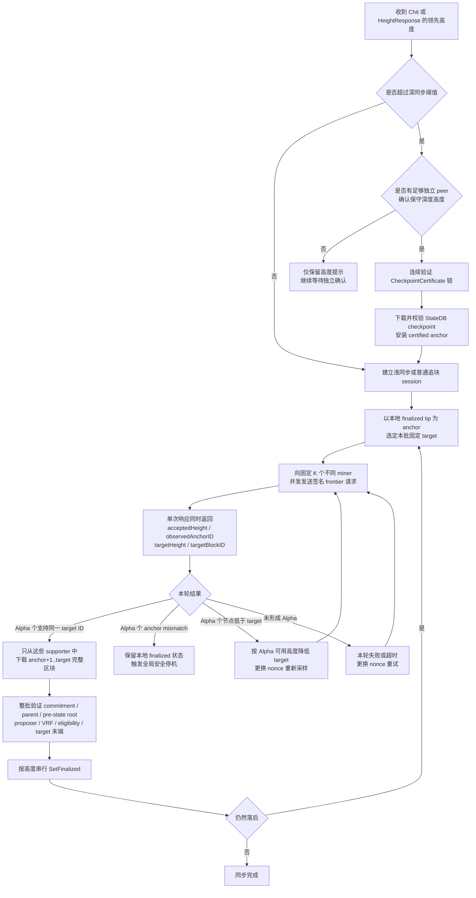

# 同步状态机与 accepted-frontier

`CheckpointCertificate` 只为深度同步的 checkpoint 提供可持久化信任锚，不为逐块追块背书。浅同步、普通追块和 checkpoint 后尾追都经过同一个 accepted-frontier 门禁；frontier 响应只属于当前 nonce 轮次，不持久化、不 gossip，也不能跨轮合票或包装成可转移证书。
