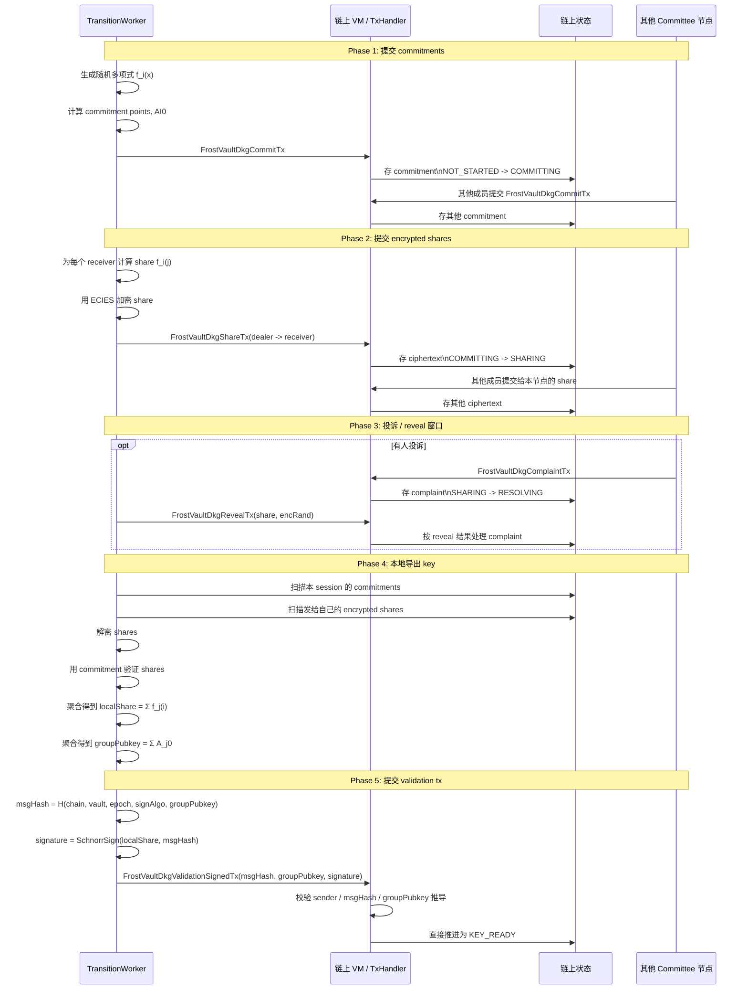
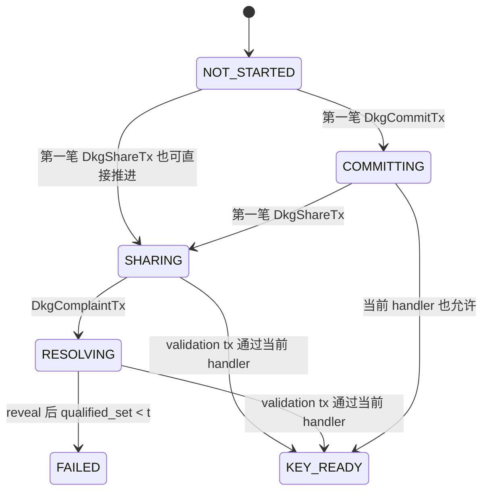
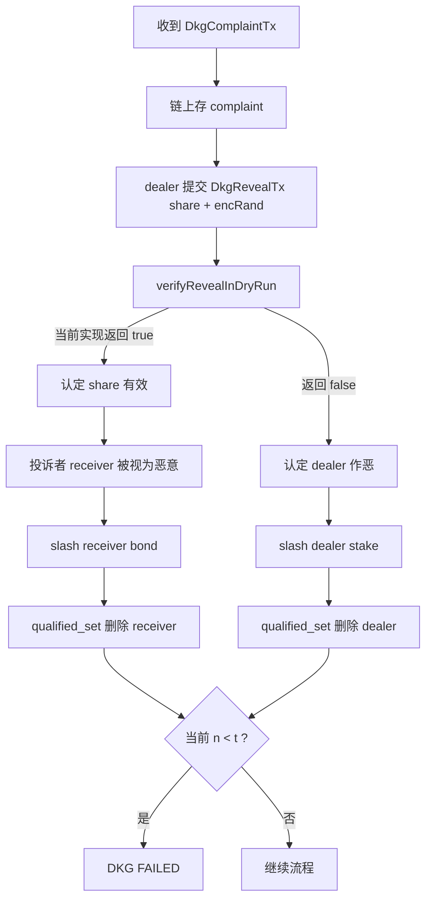
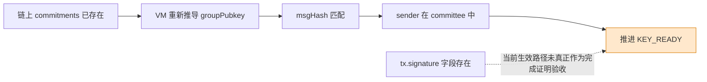
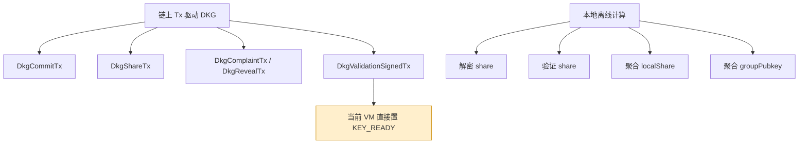
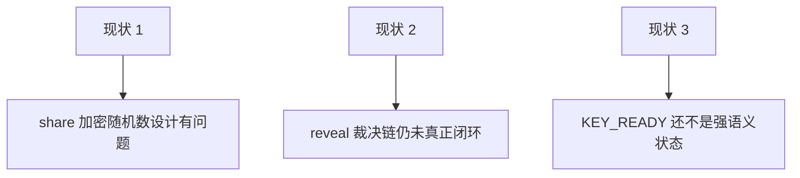
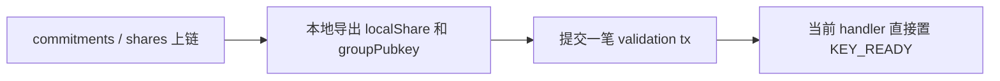

# 当前代码 DKG 实际流程图（现状版）

这份图描述的是**当前代码实际在跑的路径**，不是目标方案。

重点只有一句话：

- 当前 DKG 主路径是“链上提交 commitment/share + 本地扫描聚合 + 最后提交一笔 validation tx”
- 当前 `KEY_READY` 更接近“链上状态推进成功”，**还不是**“已经被一次真实门限聚合签名验收”

---

## 1. 当前主流程时序图

---

## 2. 当前状态机

这张图里最需要注意的是最后三条：

- 当前没有单独的 `DKG_COMPLETE`
- 当前 `KEY_READY` 不是“真实签名验收成功”后的状态
- 当前 handler 甚至允许从 `COMMITTING / SHARING / RESOLVING` 直接进 `KEY_READY`

---

## 3. 当前 complaint / reveal 实际处理

但当前真正的问题是：

- `verifyRevealInDryRun` 现在基本还是占位实现
- 所以 complaint / reveal 这条分支的密码学裁决并不可靠

---

## 4. 当前 KEY_READY 的真实含义

也就是说，当前 `KEY_READY` 更接近：

- `groupPubkey` 可以从链上 commitments 推导出来
- 有人提交了一笔 validation tx
- VM 接受了这次状态推进

它**还不等价于**：

- 新 key 已经完成过一次真实 `t-of-n` ROAST/FROST 聚合签名
- VM 已经验证过那次聚合签名

---

## 5. 当前代码的实际分层

这说明当前实现其实是：

- DKG 数学过程：主要在本地算
- DKG 输入材料：主要靠链上 tx 收集
- DKG 最终状态：靠链上 validation tx 推进

---

## 6. 当前版本的三个关键现状

---

## 7. 一句话版本

这就是当前代码的现状：

- **DKG 是能走通的**
- 但 `KEY_READY` 目前仍然偏“状态推进完成”
- 还不是你想要的“已经被真实聚合签名验收过的新 key”
