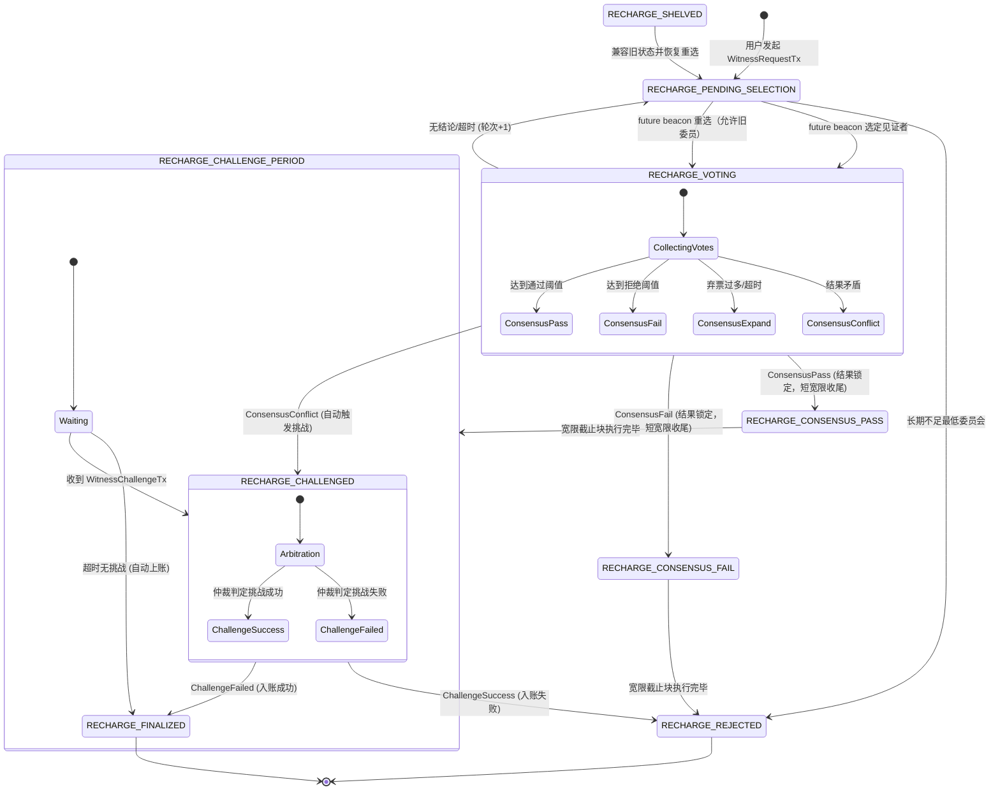
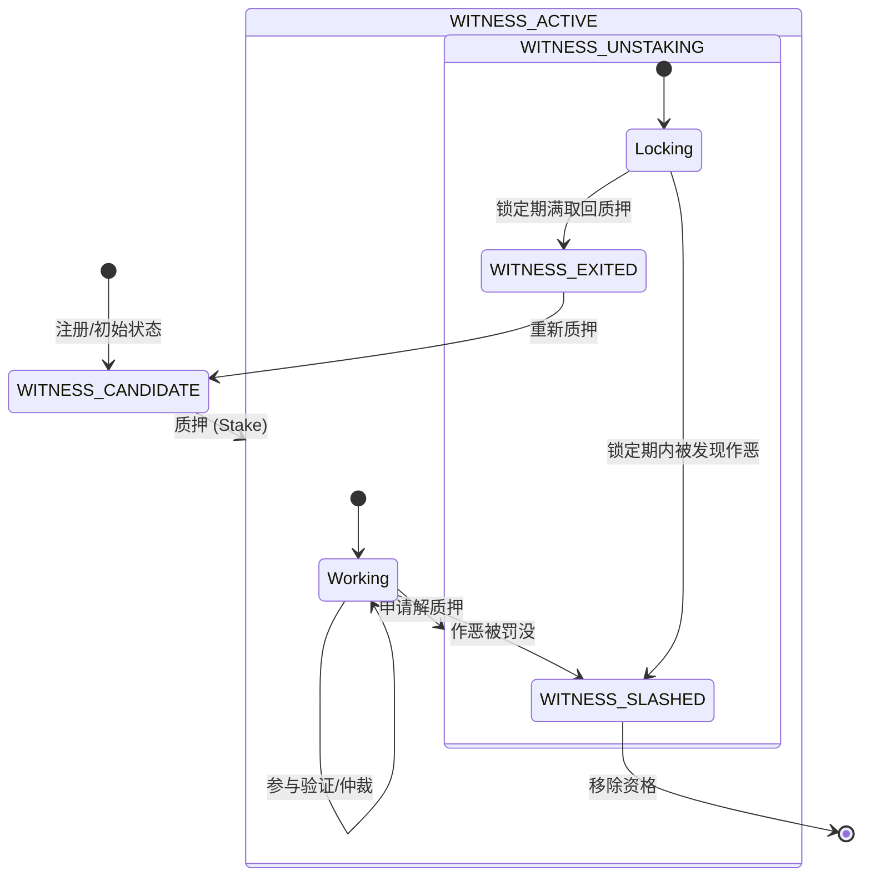

# Witness Module Code Documentation

本文档详细说明了 `witness` 模块的代码结构、核心组件以及关键流程的状态流转。

## 1. 模块概览

`witness` 模块负责处理跨链充值的验证、见证者管理、投票共识以及挑战仲裁。它通过去中心化的见证者网络确保跨链资产的安全入账。

### 核心组件

*   **Service (`service.go`)**: 模块入口，协调各个子组件，处理外部请求和事件循环。
*   **StakeManager (`stake_manager.go`)**: 管理见证者的质押、解质押、状态变更及奖励/罚没。
*   **VoteManager (`vote_manager.go`)**: 管理投票过程，收集投票并计算共识结果。
*   **ChallengeManager (`challenge_manager.go`)**: 处理挑战和仲裁逻辑。
*   **Selector (`selector.go`)**: 负责基于 VRF 和概率算法选择见证者和仲裁者。
*   **Types (`types.go`)**: 定义核心数据结构、枚举和配置参数。

## 2. 核心流程与状态流转

### 2.1 入账请求生命周期 (Recharge Request Lifecycle)

入账请求从创建到最终完成（或拒绝）经历多个状态。



### 2.2 见证者状态流转 (Witness Status Lifecycle)

见证者从候选人到活跃状态，再到退出或被罚没。



## 3. 关键代码逻辑说明

### 3.1 奖励分配 (Fee Distribution)

当入账请求进入终态（`RECHARGE_FINALIZED` 或 `RECHARGE_REJECTED`）时，系统会将 `recharge_fee` 分配给**诚实**的见证者。

*   **触发点**:
    1.  VM `KeyRechargeChallengeDue` 到期索引：公示期结束自动上账。
    2.  `Service.handleChallengeResolved`: 仲裁结束。
*   **诚实者定义**:
    *   **Finalized (成功)**: 投 `PASS` 的见证者。
    *   **Rejected (失败)**: 投 `FAIL` 的见证者。
*   **实现**: `StakeManager.DistributeReward` 平均分配费用。

### 3.2 超时重选 (Reselection)

当当前轮见证者无法达成共识（如弃票过多或超时）时，系统会安排下一轮抽签。

*   **逻辑**: `Service.expandScope`
*   **过程**:
    1.  轮次 (`Round`) + 1。
    2.  等待 future beacon，避免请求方预先 grinding 后续委员会。
    3.  从全部活跃见证者中抽取委员会，允许旧委员再次入选。
    4.  重置投票计数，开始新一轮投票。
*   **低活性兜底**:
    *   活跃人数不足最低委员会时保持 `RECHARGE_PENDING_SELECTION`，按 `RetryIntervalBlocks` 延迟重试。
    *   超过 `MaxShelveWaitBlocks` 仍无法选人时保守转为 `RECHARGE_REJECTED`。
    *   `RECHARGE_SHELVED` 不再由新流程产生，只保留旧链上记录的恢复兼容。

### 3.3 自动挑战 (Auto Challenge)

当投票结果出现严重分歧（如既有大量 PASS 也有大量 FAIL，导致无法达成一致且非弃票原因）时，系统判定为 `ConsensusConflict`。

*   **逻辑**: `Service.handleConflict`
*   **过程**:
    1.  状态转为 `RECHARGE_CHALLENGED`。
    2.  系统自动生成一个 `ChallengeID`。
    3.  选择仲裁者介入。
    4.  进入仲裁流程，由仲裁者决定最终结果。

### 3.4 自动重试与低活性仲裁终结

新请求不再进入 `RECHARGE_SHELVED`；已有旧记录仍会被兼容恢复。

*   **充值请求重试逻辑**: `Service.retryShelvedRequests`
*   **触发**: `Service.SetCurrentHeight` 每隔一定区块（`RetryIntervalBlocks`）触发一次。
*   **机制**:
    1.  检查全部活跃见证者是否足以组成最低委员会。
    2.  足够时进入 `RECHARGE_PENDING_SELECTION`，用 future beacon 重选且允许旧委员参与。
    3.  超过 `MaxShelveWaitBlocks` 仍无法恢复的旧记录会保守转为 `RECHARGE_REJECTED`。

仲裁 challenge 不再进入长期搁置状态，也没有 shelved retry 全量扫描。仲裁超时由 VM 的 `KeyChallengeTimeoutDue` 索引驱动：

```text
ACTIVE 仲裁超时
-> 达到 quorum + margin：按票强制结算
-> 未达到且 ArbitrationRound == 0：扩容一次并重置 deadline
-> 再次超时或扩容失败：低活性保守清算
```

低活性保守清算不会用低票数推翻原 witness 结果；如果原始 witness 没有明确 PASS 多数，请求转 `RECHARGE_REJECTED`，同时释放 native tx 防重锁，允许重新提交或复核。

## 4. 数据结构 (Protobuf)

主要数据结构定义在 `pb/data.proto` 中。

*   **WitnessRequestTx**: 用户发起的入账请求交易，包含 `recharge_fee`。
*   **RechargeRequest**: 系统内部维护的请求状态对象，包含当前状态、投票记录、选定的见证者等。
*   **WitnessVote**: 见证者的投票数据。
*   **ChallengeRecord**: 挑战和仲裁的记录。
*   **WitnessInfo**: 见证者的个人信息（地址、质押、状态、奖励等）。

## 5. VM 交互与数据持久化

`witness` 模块作为一个独立的逻辑单元，通过接口与主 VM (Virtual Machine) 进行交互。

### 5.1 交互方式

*   **区块高度同步**: VM 通过调用 `Service.SetCurrentHeight(height)` 驱动见证者投票超时和旧 shelved 记录恢复；充值重选由 `KeyRechargeSelectionDue(height)` 状态索引驱动，公示期到期上账由 `KeyRechargeChallengeDue(height)` 驱动，仲裁超时由 `KeyChallengeTimeoutDue(height)` 驱动。
*   **交易处理**: VM 解析区块中的交易，识别出 `WitnessRequestTx`, `WitnessVoteTx` 等，调用 `Service` 的相应方法（如 `CreateRechargeRequest`, `ProcessVote`）。
*   **资金账本衔接**: `WitnessRequestTx` 确认后写入 FundsLedger Pending 层；VM finalized 驱动或 `EventRechargeFinalized` 触发后从 Pending 移除并写入 Finalized 层。
*   **事件通知**: `Service` 通过 `Events()` 通道向 VM 发送状态变更事件（如 `EventRechargeFinalized`），VM 接收后可触发后续逻辑（如铸造 Token）。

### 5.2 数据持久化 (DB Interface)

为了解耦存储实现，`witness` 模块定义了 `DBInterface` 接口 (`service.go`)，由 VM 层传入具体实现。

```go
type DBInterface interface {
    GetWitnessInfo(address string) (*pb.WitnessInfo, error)
    SaveWitnessInfo(info *pb.WitnessInfo) error
    GetRechargeRequest(requestID string) (*pb.RechargeRequest, error)
    SaveRechargeRequest(request *pb.RechargeRequest) error
    GetChallengeRecord(challengeID string) (*pb.ChallengeRecord, error)
    SaveChallengeRecord(record *pb.ChallengeRecord) error
    GetActiveWitnesses() ([]*pb.WitnessInfo, error)
}
```

*   **数据落库**:
    *   **见证者信息**: 在质押、解质押、状态变更时保存。
    *   **请求状态**: 在创建请求、投票更新、状态流转（如进入公示期、完成）时保存。
    *   **挑战记录**: 在创建挑战、仲裁投票、挑战结束时保存。

这种设计使得 `witness` 模块不依赖具体的数据库（如 LevelDB, BadgerDB），便于测试和集成。
