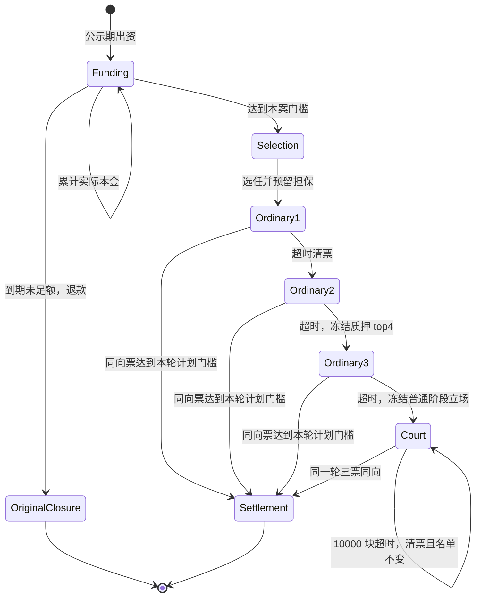

# Witness 入账、挑战与仲裁设计

本文描述 `ArbitrationProtocolVersion = 1` 的 Go 实现及本轮已确认规则，更新于 2026-09-21。代码落地与本地验证不表示已部署到运行中的链。形式化规格及验证范围见 [ARBITRATION_DESIGN.md](../formal/witness/ARBITRATION_DESIGN.md)。

## 已确认规则与可配置默认值

| 项目 | 规则 |
| --- | --- |
| 见证费 | 创建请求时从付款者实际预收 FB；终局自动分配 |
| 原见证担保 | 每地址每案 10 FB，沉默成员也预留 |
| 普通仲裁担保 | 每地址每案至少 10 FB；当前自动选任预留 10 FB，同案跨角色取较高额度，只补差额 |
| 终审担保 | 终审角色不新增担保，但保留未完案件职责，阻止领回注册质押 |
| 群众挑战门槛 | `max(10 FB, 本案原见证成员预留额度总和 × 10%)` |
| 普通仲裁 | 三轮扩容，生产每轮 10,000 块；显式 dev/local20 测试配置可用 20 块 |
| 终审 | 第三轮开始冻结合格注册见证者中质押最多的四个地址；三票同向结案 |
| 终审超时 | 按本案冻结期限清票重投，固定同一名单，不降门槛，不推定胜负 |
| 离线 | 不因沉默罚款；已提交的有效方向立场仍按终局判断 |
| 金额 | FB 使用 8 位精度，10 FB = `1000000000` 最小单位；资金运算只用整数 |

普通三轮计划人数 `4 / 8 / 16` 和门槛 `7500 bps` 是当前可配置默认值。用户仅同意参数化验证，尚未确认正式上线人数和普通门槛；不得把默认值当成已批准的生产协议参数。人数必须从至少四人开始严格递增，普通门槛须大于 50% 且不超过 100%，立案时快照到案件。原见证人数、原见证共识门槛、公示期、投票宽限期和退出锁定期读取各自配置，不能套用普通仲裁参数。当前公示期默认 300 块。

## 请求与原见证

1. `WitnessRequestTx` 校验外链资产、充值事件或 BTC outpoint 身份及防重锁，创建待选人请求。`RechargeFee` 从 `RequesterAddress` 的 FB 可用余额转入 `__witness_fee_pool__`；`FeeEscrow` 只是这笔协议账户余额的按案归属记录，不能重复计入总资产。

新创世首发链 `chain_id=51025` 从第一笔请求起要求至少 `0.01 FB` 见证费，另外从提交者 FB 可用余额实际锁定 10 FB 到独立的 `__witness_requester_bond_pool__`，并为提交者写入名义资产 claim。任何最终 `RECHARGE_REJECTED`（包括选人不足、超时、仲裁或上账配置复验失败）都从该池销毁 10 FB，并同块减少 FB `TotalSupply`；`RECHARGE_FINALIZED` 则原额退还。租金清户先把待结押金的真实池余额转入回收 fund，之后终局不得再退还或销毁。此规则与见证费和见证者按案担保独立；历史测试数据不作为新创世的请求规则。

同一 `51025` 首发规则还在**成功入账**时从外链已验证的 gross 充值量 `G` 内部分配两笔奖励：提交者 `S=floor(G/10000)`，最终正确且合格的见证者共同领取 `W=S`，接收者净到账 `G-2S`。Vault 可用额、累计 credited ledger 和桥币 `TotalSupply` 均只增加 `G`；失败请求不铸桥币、不发该奖励。原见证结论使用冻结的合法方向票，挑战后的 PASS 使用仲裁结算当场冻结的合格名单；奖励为正却没有合格见证者时整个上账回滚。同一地址兼任角色时先合并余额增量，一次写入。请求的 `economics_policy` 创建后不可更改，终态保留 gross/net/两笔奖励总额；每个实际获益 owner 另有 `KeyRechargeRewardOwner(owner, requestID)` 冷查询归因记录（各角色份额独立），其历史不参与 StateDB 状态根。
2. VM 通过 `KeyRechargeSelectionDue` 和 future beacon 选人，整组预留本案担保成功后进入原见证投票。重新选人允许旧委员再次入选；同案同址已有准备金不重复扣留。
3. `PASS` 表示外链充值有效，`FAIL` 表示无效，`ABSTAIN` 表示没有新的方向判断。达到原见证配置门槛后锁定结果；若启用宽限期，截止高度内合法迟到票仍可记录，但不能推翻已锁定的原判。
4. 原判通过后进入公示。当前原判失败直接拒绝，不进入群众募资公示。原见证未能形成结果时按原见证重选规则处理；原见证选人不足的等待上限不适用于已立案仲裁。
5. 公示期没有足额挑战时，先退还未凑足门槛的挑战本金，再按原请求结果结案。无挑战结案不处罚与原判不同的原见证票，只给合格正确立场地址分见证费并释放所有本案担保和职责；无合格收款人则销毁见证费。

原见证冲突判定仍可触发协议自动仲裁。自动仲裁没有群众出资，不伪造挑战本金；它与已出资案件使用同一轮次及按案结算规则，空出资奖励组按空组规则销毁。

## 挑战募资与仲裁

群众挑战只能在请求的公示期内出资。每笔新出资至少 10 FB，按地址累计实际出资，并写入独立贡献明细及租金资产 claim。门槛基数取本案原见证角色的 `OriginalAmount` 快照：每名原见证 10 FB，包含沉默成员；同址后续提高普通仲裁担保不能抬高这个基数，也不按外链充值金额报价。

资金不足时案件保持 `CHALLENGE_FUNDING`，请求仍在公示；公示结束原额退还尚存托管本金。资金达到门槛后才进入 `CHALLENGE_PENDING_SELECTION` 并锁定请求的挑战关联。立案后不再募集本金，不能因超时把本金罚给另一方。

每轮 `deadline = startHeight + arbitration_period_blocks`，生产期限为 10000；只有显式 `arbitrationTimingProfile=dev/local20` 可配置 20。期限随案件持久化，后续配置变更或重启不改变旧案；缺少该字段的旧活跃案继续使用 10000。截止高度内仍可投票，`deadline + 1` 才执行超时换轮。普通门槛按本案冻结的计划人数计算，不能按实际到场人数降低门槛。候选不足时不能虚构成员或降低通过票数；第三轮不足四名合格终审人选时等待重试，不产生终局。

第三轮开始时按注册质押从高到低取四人，质押相同按地址排序。即使第三轮普通仲裁直接结案，这四个地址也已属于本案终审名单，适用罚金排除规则。进入终审后，成员随后退出或质押下降不能撤销旧职责或换人。终审允许无限等待，不存在低活性保守清算、默认维持原判或按沉默惩罚。

`ArbitrationVoteTx.BallotRound` 必须绑定当前轮次；投票身份还必须是当前委员会成员，且每案每轮每地址只能投一次。所有仲裁票均为外链实际 `PASS / FAIL / ABSTAIN`，不是“支持或反对原判”。终局是否挑战成功由最终外链方向与原判方向是否不同确定。

## 有效立场、担保与退出

每轮计票清零，禁止跨轮合票；计票和阶段奖惩立场分开保存。普通仲裁阶段尚未结束时，同址可在后续轮次纠正，阶段结束时冻结每地址最后一张合法方向票。历史方向票不再单独奖罚，弃权也不能抹掉已有方向票。原见证阶段的最后方向立场独立保存，不能被普通仲裁或终审票覆盖。

案件经过仲裁获得终局时，任一已冻结的原见证或普通仲裁立场错误，该地址就失去全部见证费和罚金奖励，并被一次扣完本案准备金。另一角色投对不能免罚；多轮或多个错误角色也不重复罚没。不从同址其它案件准备金或全部注册质押追加扣款。

注册质押是 `WitnessLockedBalance` 的真实资金。`ReservedStakeAmount` 为所有未完案件的准备金合计，`ActiveCaseCount` 包含零担保的终审职责，二者都是限制而不是新增资产。申请退出立即停止承接新案，旧职责继续；锁定期满且全部案件已释放后，才可通过 `WitnessClaimStakeTx` 领回剩余注册质押。单纯终审投错或缺席没有该角色担保罚款，但同址原见证/普通仲裁的既有责任仍有效。

## 真实资金结算

终局先从本案担保实际扣款，得到本案实际罚金；不能按名义质押或配置比例先算奖励再增发补差。成功本金退款与领奖资格分开，终审成员或有错误冻结立场的出资地址，挑战成功时仍退本金。

| 资金 | 收款规则 | 无合格收款人 |
| --- | --- | --- |
| 所有案件的预收见证费 | 最终一致且未被错票排除的有效地址均分，含终审；跨轮跨角色按地址只算一次 | 全部销毁 |
| 挑战成功的本金 | 按各地址实际尚存出资原额退款 | 无出资则无本金流转 |
| 挑战成功的实际罚金 10% | 销毁 | 固定销毁 |
| 挑战成功的实际罚金 45% 出资池 | 合格出资者按合格出资比例分配 | 只销毁本组份额，不转另一组 |
| 挑战成功的实际罚金 45% 正确投票池 | 合格正确原见证/普通仲裁地址均分 | 只销毁本组份额，不转另一组 |
| 挑战失败的本金与实际罚金 | 合并后均分给合格正确原见证/普通仲裁对手方；包含错误普通仲裁者被扣的本案担保 | 合并池全部销毁 |

本案终审名单中的地址完全排除所有罚金池及失败本金分配，即使同时是出资者、原见证或普通仲裁。没有错误原/普通冻结立场时，其正确角色仍可获得一份见证费；只有终审角色的地址，仅用最终裁决轮的正确有效票取得见证费，旧终审轮次不算。合格非终审地址若既出资又投对，可以分别获得两个 45% 池的奖励，各组内部只计算一次。

所有比例分配使用整数最大余数法。10/45/45 分池余数相同按“销毁、出资池、正确投票池”固定顺序补最小单位；组内按地址排序打破相同余数，等额分配按地址顺序补一。既不丢尾数，也不生成小数余额。

VM 在同一 StateView 快照内完成扣款、分配/销毁、贡献及租金 claim 清理、担保释放和终态持久化；失败整体回滚。`FeeSettled` 和 `ChallengeRecord.Settled` 结合 canonical 状态防止旧事件或重复投票再次支付。销毁对应减少 FB `TotalSupply`，正常奖励是已有余额转移。旧 `PendingReward` 不是可兑现资金来源；旧余额领取入口明确拒绝无来源奖励，不允许通过增加 `TotalSupply` 补账。

## 入账、防重与状态保存

充值资产仅在有效终局入账时写接收方余额、桥接 token 供应量、Vault 可用余额及已入账账本，并在同块写 credited 标记。创建 Witness 请求不等于已增加可提现余额。

账户链按 `chain + nativeTxHash + depositEventIndex` 锁定同一充值事件；BTC 按 canonical `txid + vout` 锁定 outpoint。成功入账保留消费标记；拒绝仅释放属于当前请求且尚未 credited 的待处理锁。外链金额及事件真实性由链外验证者核验，共识执行不调用外链 RPC。本案担保不承诺覆盖任意外链充值价值，挑战门槛也不随申报充值额增长。

未完请求、`FUNDING / PENDING_SELECTION / ACTIVE` 挑战、实际本金、担保、冻结立场和终审名单均是 StateDB 执行真源。到期路径分别由选人、公示、宽限和仲裁 timeout 索引驱动，不每块全扫历史。

结算完成后，完整请求、投票、挑战与贡献进入 archive，热状态保留 compact marker。必须先结清资金、释放职责、清除贡献及租金 claim，再压缩掉详细担保和投票；不得用归档或缓存作为活跃案件资金真源。

原见证的地址→案件分配为 query 投影：当前待投任务与未结案历史参与分别索引，不进入 StateDB。历史参与者从完整 CaseCollateral 的原见证角色、当前委员会及已记立场恢复；结案按完整参与者删除分配，投票按 requestID 前缀全部归档后删除，不能只处理最后一轮。启动、checkpoint 安装和认证锚恢复会先排空写队列再重建索引；重建不改变状态根，失败不展示半成品。旧版 `wassign_` 保持原 State 分类，由首次新版本共识执行统一删除并写迁移标记；部署必须统一版本，不能各节点自行改根。旧终态中不再被触及的独立投票历史不做启动全库扫描清理。

## 版本与迁移边界

新请求预收见证费后记录协议 v1。缺少版本或版本为 0 的旧活动案件没有可直接信任的预收费托管和按案准备金；原选人、群众募资、开始仲裁新轮及仲裁投票入口会明确要求迁移，不能无声进入新担保流程。旧终态仍可查询。

当前尚未确定旧活动案件迁移方案、升级高度或测试链重置方案，也没有把上述门槛检查当作已完成迁移。迁移必须明确旧本金的真实来源、旧见证费如何处理、按案准备金如何建立；不能只改版本号，也不能为补齐旧账增发或追收未经明确规定的费用。
